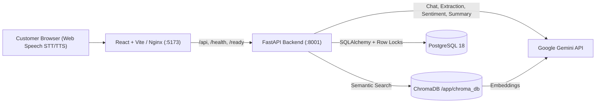

# Project Report — Autonomous AI Sales Voice Agent (FORTIVEX AI PRIVATE LIMITED)

## 1. Objective & Business Problem
Businesses lose qualified leads due to slow manual response times, inconsistent discovery calls, and fragmented CRM updates. This project implements an **Autonomous AI Sales Voice Agent** that engages prospects via browser voice or text, answers company questions using grounded RAG retrieval, qualifies leads into PostgreSQL, adapts to customer sentiment, books conflict-free appointments, and surfaces manager-ready call summaries and analytics.

## 2. Technology Stack
- **Frontend:** React 19, Vite 8, JavaScript, Tailwind CSS v4, Axios, React Router DOM, Lucide React, Recharts, Browser Web Speech API (`SpeechRecognition` + `speechSynthesis`).
- **Backend:** Python 3.11, FastAPI, Uvicorn, Pydantic v2, SQLAlchemy 2.1, `psycopg2-binary`, `python-dotenv`, `google-genai` (`gemini-3.5-flash-lite` + `models/gemini-embedding-001`).
- **Data & Infrastructure:** PostgreSQL 18 (`postgres:18-alpine`), ChromaDB (`1.5.9`), Docker Compose + Nginx reverse proxy.

## 3. System Architecture & End-to-End Flow

```text
  ┌─────────────────────────┐     1. Voice / Text      ┌──────────────────────────────────┐
  │    Customer Browser     │ ───────────────────────▶ │  React + Vite UI (Nginx :5173)   │
  │ (Chrome/Edge Web Speech │ ◀─────────────────────── │  Push-to-Talk / Continuous Mode  │
  │    STT + TTS Audio)     │     6. Reply + Audio     └────────────────┬─────────────────┘
  └─────────────────────────┘                                           │ 2. /api/* Proxy
                                                                        ▼
  ┌─────────────────────────┐     3. Semantic Search   ┌──────────────────────────────────┐
  │   ChromaDB (/chroma_db) │ ◀──────────────────────▶ │     FastAPI Backend (:8001)      │
  │  5 Docs / 42 KB Chunks  │    (Grounded Context)    │  • Sentiment & Booking Intent    │
  └────────────┬────────────┘                          │  • Lead Extraction & Memory      │
               │                                       │  • Appointment Row-Locking       │
               │ Embeddings                            └────────┬───────────────┬─────────┘
               ▼                                                │ 4. AI Calls   │ 5. Persist
  ┌─────────────────────────┐                                   ▼               ▼
  │    Google Gemini API    │ ◀─────────────────────────────────┘   ┌─────────────────────┐
  │ gemini-3.5-flash-lite   │                                       │  PostgreSQL 18 (db) │
  │ gemini-embedding-001    │                                       │ Leads, Msgs, Appts, │
  └─────────────────────────┘                                       │ CRM, Summaries      │
                                                                    └─────────────────────┘
```

<details>
<summary>Mermaid Diagram Source (renders on GitHub / Mermaid-enabled viewers)</summary>



</details>

## 4. End-to-End Business Workflow & AI Implementation
1. **Voice & Chat:** Push-to-talk (default) and Continuous modes use a strict frontend state machine (`idle -> listening -> processing -> speaking -> idle`) to prevent microphone echo loops.
2. **RAG Knowledge Retrieval:** Five researched Markdown files in `backend/app/knowledge_base/` are chunked (`500` chars / `80` overlap), embedded with `models/gemini-embedding-001`, and queried via cosine similarity (`score >= 0.35`). The agent abstains when evidence is missing.
3. **Lead Qualification & Memory:** `leads` and `conversation_messages` persist session history and structured BANT fields (`NEW | HOT | WARM | COLD`) using Pydantic-validated JSON extraction with a single controlled retry.
4. **Sentiment Analysis:** Classifies each customer turn (`POSITIVE | NEUTRAL | FRUSTRATED | NEGATIVE`), adapts the agent's tone, computes directional trends (`improving | stable | declining | insufficient_data`), and keeps qualification independent from sentiment.
5. **Appointment Booking & CRM:** `appointment_intent_service.py` detects scheduling intent, while `appointment_service.py` generates real slots (Mon–Fri, 09:00–18:00, 30m + 15m buffer — configurable MVP defaults) and executes bookings inside PostgreSQL transactions with `SELECT ... FOR UPDATE` row locking. All events log to `crm_activities`.
6. **Summaries & Analytics:** `summary_service.py` persists versioned `conversation_summaries` (with deterministic fallback on Gemini rate limits); `analytics_service.py` aggregates leads, sentiment, appointments, booking rates, and sales insights with UTC date filters.

## 5. Database Design & Key APIs
- **Tables:** `leads` (1) → `conversation_messages` (N), `leads` (1) → `appointments` (N), `leads` (1) → `crm_activities` (N), `leads` (1) → `conversation_summaries` (1).
- **APIs:** `/health`, `/ready`, `/api/agent/chat`, `/api/agent/session/{id}`, `/api/knowledge/{ingest,search,documents,status}`, `/api/appointments/{availability,,id,id/cancel,id/reschedule}`, `/api/crm/leads/*`, `/api/summaries/*`, `/api/analytics/*`.

## 6. Verification Status, Limitations & Commercial / Scaling Roadmap
- **Implemented & Verified:** Docker Compose 3-container startup (`db`, `backend`, `frontend` healthy), `/health`, `/ready`, RAG ingestion/search, Gemini chat, lead qualification, sentiment, appointments, CRM, summaries, analytics, `oxlint`, and `vite build`.
- **Implemented, Manual Browser Testing Pending:** Live Chrome/Edge microphone STT and speaker TTS playback.
- **MVP Limitations:** CRM, summary, and analytics endpoints lack JWT/OAuth RBAC; external CRM (HubSpot/Salesforce) and Google Calendar sync are not yet connected; `docker-compose.yml` is a single-host MVP.
- **Commercial Feasibility (Illustrative Models):** SaaS subscription tiers (per-seat/conversation), usage-based voice minutes, and enterprise custom deployments (no official FORTIVEX pricing implied).
- **Scaling to 100k Users (Proposed):** Stateless FastAPI replicas behind a load balancer, managed PostgreSQL + read replicas, Redis session/cache tier, async worker queues (Celery/ARQ) for summarization/ingestion, S3/GCS storage, and centralized observability. *(100k registered users ≠ 100k simultaneous voice streams; voice concurrency scales via WebRTC/media gateways.)*
