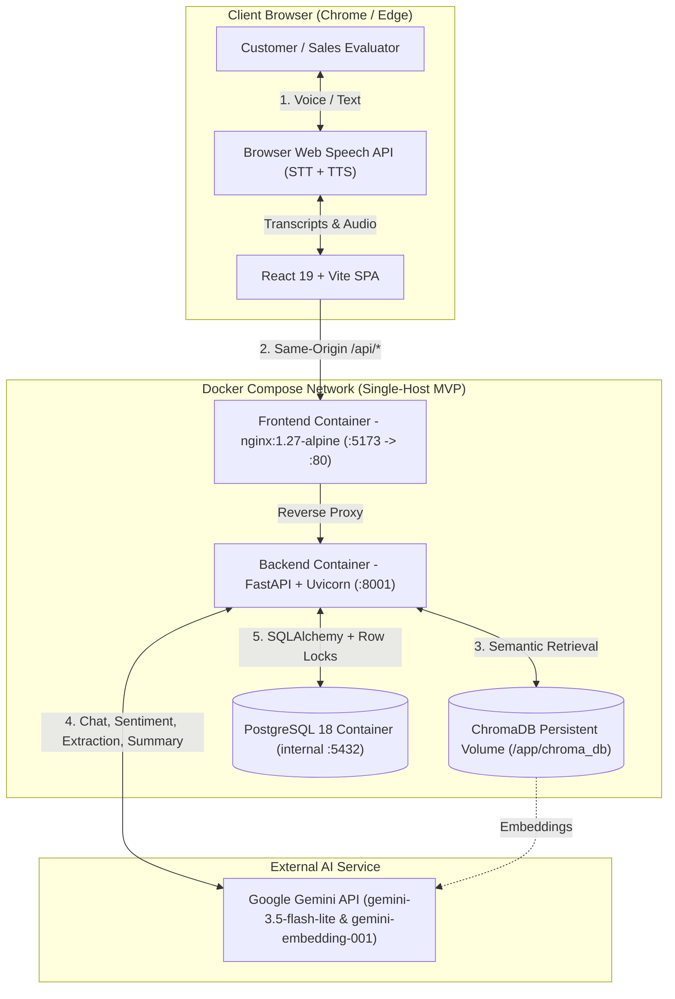

# System Architecture & Flow — Autonomous AI Sales Voice Agent

This diagram reflects the **actual implemented MVP architecture** verified against `docker-compose.yml`, `frontend/nginx.conf`, and `backend/app/`.

## Easy-to-Explain Visual Flow (Steps 1 → 6)

```text
  ┌─────────────────────────┐     1. Voice / Text      ┌──────────────────────────────────┐
  │    Customer Browser     │ ───────────────────────▶ │  React + Vite UI (Nginx :5173)   │
  │ (Chrome/Edge Web Speech │ ◀─────────────────────── │  Push-to-Talk / Continuous Mode  │
  │    STT + TTS Audio)     │     6. Reply + Audio     └────────────────┬─────────────────┘
  └─────────────────────────┘                                           │ 2. /api/* Proxy
                                                                        ▼
  ┌─────────────────────────┐     3. Semantic Search   ┌──────────────────────────────────┐
  │   ChromaDB (/chroma_db) │ ◀──────────────────────▶ │     FastAPI Backend (:8001)      │
  │  5 Docs / 42 KB Chunks  │    (Grounded Context)    │  • Sentiment & Booking Intent    │
  └────────────┬────────────┘                          │  • Lead Extraction & Memory      │
               │                                       │  • Appointment Row-Locking       │
               │ Embeddings                            └────────┬───────────────┬─────────┘
               ▼                                                │ 4. AI Calls   │ 5. Persist
  ┌─────────────────────────┐                                   ▼               ▼
  │    Google Gemini API    │ ◀─────────────────────────────────┘   ┌─────────────────────┐
  │ gemini-3.5-flash-lite   │                                       │  PostgreSQL 18 (db) │
  │ gemini-embedding-001    │                                       │ Leads, Msgs, Appts, │
  └─────────────────────────┘                                       │ CRM, Summaries      │
                                                                    └─────────────────────┘
```

### How to Explain Each Step in 30 Seconds
1. **Capture:** Customer speaks (Web Speech STT) or types in the React UI.
2. **Proxy:** Nginx forwards `/api/*` requests to FastAPI (`backend:8001`).
3. **Ground (RAG):** FastAPI queries ChromaDB for relevant company docs (`score >= 0.35`).
4. **Reason (Gemini):** Gemini analyzes sentiment, detects booking intent, generates a grounded reply, and extracts structured lead fields.
5. **Persist (PostgreSQL 18):** FastAPI saves messages, sentiment, lead status (`HOT/WARM/COLD/NEW`), row-locked appointments, CRM activities, and summaries.
6. **Respond:** React updates the chat, Lead/Sentiment/CRM panels, and speaks the reply via Browser TTS.

---

## Mermaid Diagram (for GitHub / Mermaid Viewers)


